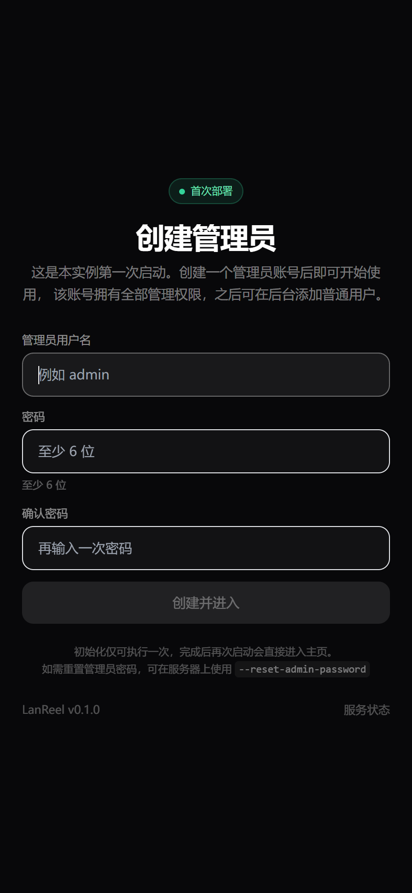

# LanReel

局域网随机视频流媒体系统：部署在 Windows / Linux（含 NAS）主机上，用浏览器以抖音式竖屏滑动方式浏览指定文件夹里的视频与图片，支持注册登录、跨设备收藏同步与管理员后台。

**当前版本：v0.3.2（可运行）** — 前后端已完成并在浏览器实测通过。Go 单二进制内嵌前端，启动即用。

下载：见 [Releases](https://github.com/zys747526271/lanreel/releases)（Windows x64 单文件，解压即用）；发布说明见 [docs/releases/v0.3.2.md](./docs/releases/v0.3.2.md)。

<p>
  
  
  
  
</p>

## 特性

**浏览体验**
- 全屏竖屏滑动（触摸 / 鼠标上下拖动 / 滚轮 / 键盘 ↑↓），视频自动播放、离开即暂停；空格暂停/继续，长按 ← → 快进回退
- 进度条按下才跳转、按住可拖动，悬停不再误跳；收藏夹为缩略图网格，点开全屏滑动浏览
- 图片按配置时长（默认 5 秒）自动切换，底部有停留进度提示
- 视频支持拖拽进度、HTTP Range 断点续播，缓存头 `public, max-age=86400`
- 收藏夹独立成页（缩略图网格），与随机流分离，一屏一媒体、切换零刷新
- 长按画面进入倍速模式（默认 1.5×，上下滑动调 0.5×~3×，松手保持；参考 Kazumi 手势），单击底部提示恢复原速
- 每条播放器带全屏按钮，视频/图片按原始比例显示（黑边填充，不拉伸）
- 快进/倍速时只保留底部进度条与时间，其余 UI 自动隐藏
- 从设置 / 后台返回会回到进入前的视频与播放进度，不会退回第一条
- 播放结束可选暂停 / 循环 / 自动下一个；观看进度按账号云端同步，历史/收藏打开自动续播并可「从头开始」

**内容管控**
- 管理员可对文件夹、单文件分别设置「可播 / 禁用 / 时间窗口（支持跨零点）」
- 策略优先级：文件级覆盖 > 文件夹策略（最长前缀）> 默认允许；根目录策略作为全局默认
- 被限制的内容仍保留在收藏中，以模糊预览 + 原因提示展示，不会静默消失
- 策略或媒体目录变更后通过 SSE 广播版本号，所有在线页面实时重查权限；当前视频被禁会自动跳过下一条，重新开放后列表自动恢复
- 时间判断全部在服务端完成，时区可配置

**账号与收藏**
- 注册（受管理员开关控制）、JWT 登录、令牌自动刷新、登出清缓存
- 观看历史与播放进度按账号隔离，管理员与每个普通用户互不干扰
- 收藏以「媒体源 + 相对路径」哈希标识，迁移文件夹不失效；服务端为准，跨设备即时同步；按钮显示的是该视频的收藏数
- 前端用 IndexedDB 缓存收藏，断网时展示缓存并标记「离线」；观看统计（视频数/完播数/时长）与热度排行可在设置页和管理端查看

**账号与可见性**
- 未登录即游客：直接输入 IP 就能看管理员开放的内容；登录后可见范围更大、可收藏
- 每个文件夹/文件策略分别设置「普通用户可见」与「游客可见」，且两者播放时段各自独立；策略按媒体根隔离，多根下同名目录互不影响
- 添加媒体目录可选递归导入子目录；文件夹策略以树形管理（根可折叠子目录），根目录策略可一键同步到所有子目录
- 登录失败按 IP + 用户名双维度限流，超限返回 429 并记录告警

**可诊断性**
- 后端按 13 个分类写入独立的 `logs.db`（异步批量、失败降级文件），后台可按分类 / 级别 / 时间 / 关键字 / 请求 ID 检索
- 前端按分类写入 IndexedDB `app_logs`，设置页可查看、导出（自动脱敏密码与 Token）
- 管理员所有写操作进审计日志，独立保留、不随运行日志清理

**部署与资源**
- 单二进制（26MB，含前端），`CGO_ENABLED=0` 可交叉编译
- 首次部署在浏览器内创建管理员，之后每次启动直接进主页（无浏览器可用 `ADMIN_INIT_PASSWORD` 预置）
- 媒体目录可在后台「媒体目录」增删（内置目录浏览器），保存后立即热重扫，无需改配置或重启
- 文件监听：目录内容变化 2 秒去抖后自动扫描（定时扫描仍作为兜底）
- 封面由浏览器抽帧：收藏夹/历史页自动抽首帧并缓存到 IndexedDB，悬停分段跳播预览整段视频（服务端不再生成缩略图、无需 ffmpeg）
- 不做服务端转码、不缓存媒体本体；空闲内存实测 ~28MB
- `GOMEMLIMIT` / `GOMAXPROCS` 通过环境变量注入，便于与前台游戏共存

## 快速开始

```bash
# 1) 构建（Go 1.25+、Node 20+）
./scripts/build.sh          # Windows 可用 scripts/build.ps1 或 make build

# 2) 配置：先填 media.roots 指向你的媒体目录（也可启动后在后台「媒体目录」里改）
cp server/configs/config.example.yaml config.yaml

# 3) 启动（Windows 为 dist\lanreel.exe）
./dist/lanreel --config config.yaml
```

打开 `http://<本机或局域网IP>:8080`：

- **首次部署**：页面自动进入「创建管理员」，设置用户名与密码后直接进入主页。
  该页面只在实例尚未初始化时出现，之后的每次启动都直接进主页（未登录则到登录页）；
  创建成功后接口即失效，不会出现「谁先打开谁当管理员」。
- **管理员**：用你创建的管理员账号登录，浏览页右上角出现「后台」，或从设置页「管理后台」进入 `/admin`。
- **游客**：直接访问即浏览，只能看策略里勾选「游客可见」的内容；收藏、设置等需要登录。
- **普通用户**：从登录页「注册」自助注册（管理员可在后台关闭该入口），可浏览与收藏；
  访问 `/admin` 会进入权限说明页，提示当前账号与切换账号入口。

无浏览器的部署（容器 / 自动化）仍可按配置预置管理员：启动时提供 `ADMIN_INIT_PASSWORD`，
服务会直接创建 `auth.username`（默认 `admin`）并跳过初始化页面。
两者只需选一种：预置了密码就不会再出现创建页面。

忘记管理员密码：带上 `ADMIN_INIT_PASSWORD` 与 `--reset-admin-password` 重启一次即可重置
（不带该参数不会改动已有密码）。若管理员用户名与 `auth.username` 不同，会重置最早创建的那个管理员。

> 只想先看看效果？准备一个文件夹放几段 MP4 和几张图片，`media.roots` 指过去即可；
> 也支持 `LANREEL_MEDIA_ROOT=/path/to/media` 环境变量。

其他命令：

```bash
# 前端开发模式（热更新，/api 代理到 127.0.0.1:8080）
cd server && go run ./cmd/lanreel          # 终端 1
cd web && npm run dev                      # 终端 2 → http://localhost:5173

# 检查
cd server && go vet ./... && go test ./...
cd web && npx vue-tsc --noEmit
```

> Makefile 提供等价目标：`make web` / `make server` / `make build` / `make test` / `make clean`，
> 其中 `make build` 会依次执行前端构建、内嵌资源同步与后端编译。

## 目录结构

```
.
├── server/                    Go 后端（Gin + modernc/sqlite，纯 Go 无 CGO）
│   ├── cmd/lanreel/           入口：配置 → 建库迁移 → 扫描 → HTTP → 日志清理
│   ├── internal/api/          HTTP 层（路由、中间件、处理器，仅做协议适配）
│   ├── internal/service/      业务层（认证、媒体、收藏、管理员）
│   ├── internal/media/        媒体源与扫描、video_key、MP4 时长探测
│   ├── internal/policy/       可见性与时间窗口判定
│   ├── internal/logging/      分类日志 + 异步批量落库 + 检索
│   ├── internal/repository/   数据访问（业务库）
│   ├── internal/database/     连接与版本化迁移（业务库 / 日志库各自独立）
│   ├── internal/auth/         bcrypt + JWT
│   ├── internal/webui/        内嵌前端产物（构建时填充）
│   └── configs/               配置示例
├── web/                       Vue 3 前端（Vite + TS + Tailwind，后台 Naive UI）
│   └── src/
│       ├── views/             浏览页、登录注册、设置诊断、admin/* 后台
│       ├── components/reel/   滑动容器与播放器（二者解耦）
│       ├── api/               统一请求层（鉴权、刷新、错误、日志）
│       ├── stores/            Pinia：auth / feed / favorites
│       └── lib/               IndexedDB、分类日志、格式化
├── docs/
│   ├── requirements/          需求管理（原始 / 版本 / 已完成 / 未完成 / 变更）
│   └── screenshots/           界面截图
├── deploy/                    systemd、Dockerfile、docker-compose、部署说明
├── scripts/                   构建辅助与自签证书脚本
└── Makefile
```

## 架构

```
浏览器 / 手机 / 电视（未来）
        │  HTTPS(可选) + JWT
        ▼
┌──────────────────────────────────────────────┐
│ Go 单二进制 (Gin)                             │
│  middleware: request_id → auth → admin → 访问日志│
│  api  ──► service ──► repository ──► lanreel.db │
│                 │                              │
│                 ├──► media.Scanner（快照 + 定时重扫）
│                 ├──► policy.Evaluator（策略判定）
│                 └──► logging.Logger ──► logs.db │
│  内嵌 web/dist（SPA，history 路由回退）          │
└──────────────────────────────────────────────┘
        │ http.ServeContent（Range / ETag）
        ▼
   本地媒体文件（只读，不转码）
```

分层目的：`handler` 只做协议适配，`service` 承载业务，`repository` 隔离存储——
未来换 PostgreSQL、加 GraphQL/gRPC 网关或远程日志聚合时，上层无需改动。

## 配置

完整示例见 [`server/configs/config.example.yaml`](./server/configs/config.example.yaml)，常用项：

| 配置 | 说明 | 默认 |
|------|------|------|
| `media.roots` | 媒体根目录（可多个）；后台「媒体目录」保存后会覆盖此项 | `./media` |
| `media.watch_enabled` | 是否启用文件系统监听 | `true` |
| `media.watch_max_dirs` | 监听目录上限，超过则退回定时扫描 | `4096` |
| `auth.login_max_attempts` | 登录失败次数上限（窗口内） | `5` |
| `auth.login_lock_minutes` | 触发限流后的锁定时长（分钟） | `5` |
| `media.scan_interval_seconds` | 定时重扫间隔，0 表示仅启动扫描 | `60` |
| `media.image_display_seconds` | 图片停留秒数 | `5` |
| `app.timezone` | 时区（影响时间窗口与日志时间） | `Asia/Shanghai` |
| `database.path` / `logging.path` | 业务库 / 日志库文件 | `./data/lanreel.db`、`./data/logs.db` |
| `server.tls.enabled` | HTTPS 开关 | `false` |
| `auth.access_ttl_minutes` | 访问令牌有效期 | `120` |

环境变量覆盖（容器化 / NAS 常用）：
`LANREEL_PORT`、`LANREEL_MEDIA_ROOT(S)`、`LANREEL_DATA_DIR`、`ADMIN_INIT_PASSWORD`、
`LANREEL_JWT_SECRET`、`LANREEL_LOG_LEVEL`、`LANREEL_TLS_ENABLED/CERT/KEY`、`LANREEL_TIMEZONE`、
`GOMEMLIMIT`、`GOMAXPROCS`。详见 [deploy/README.md](./deploy/README.md)。

## API 一览（`/api/v1`）

### 普通接口

| 分组 | 接口 |
|------|------|
| 初始化 | `GET /setup/status`、`POST /setup/admin`（仅在未初始化时生效，创建第一个管理员） |
| 公开 | `GET /health`、`GET /config/public`、`GET /events/policy`（策略变更 SSE）、`GET /events/policy/version`（版本查询/轮询兜底）、`POST /auth/register`、`POST /auth/login` |
| 认证 | `POST /auth/refresh`、`POST /auth/logout`、`GET /auth/me` |
| 媒体 | `GET /media/random?limit=&exclude=&mode=`、`POST /media/status`（批量刷新条目实时权限，v0.2.1 新增）、`GET /media/:key/stream`、`GET /media/:key/thumb`（均支持游客，带失效令牌返回 401） |
| 收藏 | `GET /favorites`、`POST /favorites`、`DELETE /favorites/:key` |
| 观看历史/进度 | `GET/DELETE /history`、`DELETE /history/:key`、`GET/POST /progress`、`POST /progress/restart`、`GET /me/watch-summary`（均按用户隔离，v0.3.0） |
| 日志 | `POST /logs/client`（前端日志上报，默认关闭） |

### 管理接口（需 `role=admin`，共 30 个）

| 方法 | 路径 | 说明 |
|------|------|------|
| GET | `/admin/stats` | 概览统计（媒体、用户、收藏、策略、扫描、日志分布、全站观看汇总） |
| POST | `/admin/scan` | 立即触发媒体重扫 |
| GET | `/admin/folders` | 文件夹列表（含策略生效状态与继承来源） |
| PUT | `/admin/folders` | 设置文件夹策略 |
| DELETE | `/admin/folders?folder_path=` | 删除文件夹策略（回落默认） |
| GET | `/admin/files` | 文件列表（分页、关键字、文件夹过滤） |
| GET | `/admin/files/:key` | 单文件策略与可见性 |
| PUT | `/admin/files/:key` | 设置文件级覆盖 |
| DELETE | `/admin/files/:key` | 清除文件级覆盖 |
| GET | `/admin/users` | 用户列表 |
| PUT | `/admin/users/:id` | 启用/禁用、改角色、重置密码 |
| DELETE | `/admin/users/:id` | 删除用户（级联收藏） |
| GET | `/admin/users/:id/favorites` | 只读查看某用户收藏 |
| POST | `/admin/users/:id/favorites/clean` | 清理该用户的失效收藏 |
| DELETE | `/admin/favorites/:id` | 按 ID 删除收藏条目 |
| GET | `/admin/audit-logs` | 审计日志（对象类型、关键字、时间范围） |
| GET | `/admin/logs` | 运行日志（分类、级别、关键字、请求 ID、时间、分页） |
| GET | `/admin/logs/:id` | 单条日志详情（含脱敏上下文） |
| POST | `/admin/logs/purge` | 按保留策略清理运行日志 |
| GET | `/admin/settings/media` | 读取媒体目录、来源与扫描状态 |
| PUT | `/admin/settings/media` | 保存媒体目录并触发后台重扫（目录须存在） |
| DELETE | `/admin/settings/media` | 清除后台设置，回落到配置文件 `media.roots` |
| GET | `/admin/fs/dirs?path=` | 目录浏览器（`path` 为空列根/盘符，仅返回子目录） |
| GET | `/admin/watch/heat/media?limit=` | 媒体热度排行（播放/观看/收藏/完播，v0.3.0） |
| GET | `/admin/watch/heat/folders?limit=` | 文件夹热度排行 |
| GET | `/admin/watch/heat/users?limit=` | 用户观看排行 |
| GET | `/admin/recommend?limit=&exclude=` | 推荐候选（预留接口，当前按热度分返回，v0.3.0） |
| GET | `/admin/settings/logging` | 读取日志配置 |
| PUT | `/admin/settings/logging` | 更新保留天数、最大条数、级别、上报开关 |
| PUT | `/admin/settings/registration` | 开关普通用户注册 |

约定：成功 `{"data": ...}`，分页附 `meta`，失败 `{"error":{"code","message"}}`。
管理接口未带令牌返回 `401`，普通用户调用返回 `403`；媒体流因 `<video>` 无法带自定义头，支持 `?token=` 传入访问令牌。
`POST /setup/admin` 在已初始化后返回 `409 setup_completed`；`GET /config/public` 与 `/setup/status` 都会返回 `setup_required`。

> 管理接口在前端对应 `/admin` 路由组（概览 / 文件夹策略 / 文件策略 / 用户管理 / 运行日志 / 审计日志 / 系统设置）。
> 入口：用管理员账号登录后，浏览页右上角「后台」或设置页「管理后台」。普通账号访问会进入 `/forbidden` 说明页。

## 日志设计

| 项 | 后端 | 前端 |
|----|------|------|
| 存储 | 独立 SQLite `data/logs.db`（与业务库物理分离） | IndexedDB `app_logs`（与缓存 store 隔离） |
| 写入 | 内存队列 + 后台批量（满 100 条或 1 秒），失败降级 `data/logs/backend-*.log` + stderr | 批量 50 条 / 1 秒，失败降级 console |
| 分类 | `system` `scan` `auth` `access` `business` `policy` `media` `error` `frontend` | `api` `player` `interaction` `performance` `exception` `auth` `app` |
| 容量 | 保留天数 + 最大条数，启动与每日 03:30 清理 | 5000 条上限，按时间淘汰 |
| 脱敏 | 密码 / Token / Cookie 一律 `[redacted]`，上下文白名单 | 同上，导出前再次脱敏 |

审计日志（`admin_operations_log`）在业务库中**独立保留**，不随运行日志清理。

## 安全说明

- 密码 bcrypt 哈希；JWT 密钥默认自动生成并写入 `data/jwt.secret`（首次启动创建，权限 600）
- 管理员账号由启动配置初始化，不存在「谁先注册谁是管理员」
- 媒体接口为可选鉴权：无令牌按游客处理，游客只能看 `guest_enabled` 的内容；客户端只提交 `video_key`，实际路径来自扫描快照，避免路径穿越
- 管理员接口额外校验 `role=admin`，越权与写操作均留痕
- 局域网自签 HTTPS 即可；若要暴露公网，请走反向代理 + Let's Encrypt，不要直接开放端口

## 验证情况（v0.3.2）

- `go vet ./...` 无告警；`go test ./...`（media / policy / config）全部通过
- 用 3 个样本媒体（1 视频 2 图片）实测：注册登录、随机流、视频自动播放、图片 5 秒切换、
  滑动切页、收藏增删、仅看收藏、策略禁用与时间窗口拦截（`403` / 随机流过滤 / 收藏标记）、
  管理员绕过预览、后台六个页面渲染、日志分类检索、审计记录
- 浏览器（Edge headless）端到端脚本跑完整流程，控制台零报错；390×844 / 430×932 / 1440×900 三档布局无重叠
- v0.2.0 交互实测：设置页往返进度恢复、全屏比例、空格暂停、长按方向键快进、鼠标拖动切视频、长按倍速与点击退出、悬停抽帧封面、收藏/历史互切
- v0.2.1 修复实测：历史无权限条目高强度高斯模糊 + 居中原因提示；长按默认 1.5×，上滑变 2×，松手面板消失但保持 2×，点击底部提示回 1×
- v0.3.0 实测：历史按账号隔离（user1 有记录 / owner 为空）、每用户进度云端同步与续播、从头开始清零、播放次数准确（=1）、文件夹热度实时聚合、极简快进 UI 与时间 HUD、三档热度排行与推荐接口、播放时段用户/游客独立
- v0.3.1 实测：三场景手势配置页保存后即时生效；双击点赞与单击暂停分流正确；全屏首次点击即进入；收藏清理按钮仅在批量管理中出现
- 策略实时同步：服务端新增版本订阅/版本查询单测与 SSE 广播响应测试；前端采用 SSE + 前台 1.5 秒版本轮询双通道，避免视频流占满连接队列后策略消息延迟；视频 src 仅分配给当前项和相邻预载项；禁用当前项自动跳过、不可播放项可滑动跳过、开放后按原进度恢复；开放此前未加载的文件后随机流主动并入新视频并恢复继续加载
- 管理端：固定侧栏与醒目的退出登录；真实系统诊断页（数据库/媒体目录/扫描/策略/日志/前端资源/数据目录）；危险操作归入系统设置；文件策略显示热度指标；热度统计全量排序后分页，点击行可跳转并定位到对应策略或用户
- v0.3.2 修复：观看热度媒体表在名称 / 热度 / 播放等正序下，已移除文件的统计行显示「已移除 · 文件名」或 key 兜底，不再出现空白名称；新增路径快照恢复与排序回归单测
- 空闲内存 28MB（低于 N-01 的 50MB 目标）

## 文档

| 文档 | 内容 |
|------|------|
| [REQUIREMENTS.md](./REQUIREMENTS.md) | 原始需求文档 v3.1 |
| [docs/requirements/README.md](./docs/requirements/README.md) | 需求管理规范与索引 |
| [docs/requirements/versions/v0.1.0.md](./docs/requirements/versions/v0.1.0.md) | 本版范围与验收标准 |
| [docs/requirements/completed/v0.1.0.md](./docs/requirements/completed/v0.1.0.md) | 逐条需求完成情况（含实现位置与验证方式） |
| [docs/releases/v0.2.0.md](./docs/releases/v0.2.0.md) | v0.2.0 发布说明 |
| [docs/releases/v0.2.1.md](./docs/releases/v0.2.1.md) | v0.2.1 发布说明（修复版） |
| [docs/releases/v0.3.0.md](./docs/releases/v0.3.0.md) | v0.3.0 发布说明（账号隔离/进度/统计/策略） |
| [docs/releases/v0.3.1.md](./docs/releases/v0.3.1.md) | v0.3.1 发布说明（可配置手势/全屏修复/逻辑梳理） |
| [docs/releases/v0.3.2.md](./docs/releases/v0.3.2.md) | v0.3.2 发布说明（热度统计名称修复/统计收口） |
| [docs/requirements/backlog/v0.1.0.md](./docs/requirements/backlog/v0.1.0.md) | 遗留项、技术债与下版规划 |
| [docs/requirements/changes/](./docs/requirements/changes/) | 需求变更记录（CR） |
| [deploy/README.md](./deploy/README.md) | 部署、HTTPS、资源限制与排障 |

## 路线图

- **v0.1.0**：Web 端完整可用，后台可管控，日志可诊断
- **v0.2.0**：手势倍速、全屏按钮、鼠标/键盘控制、会话进度恢复、观看历史独立页、悬停抽帧封面
- **v0.2.1**：历史实时权限遮挡、Kazumi 式长按倍速（默认 1.5×、松手保持）
- **v0.3.0**：历史按账号隔离、每用户进度续播与统计、播放结束行为、极简快进 UI、用户/游客独立时段、文件夹递归导入与热度排行、推荐接口预留
- **v0.3.1**：普通/沉浸/全屏三场景手势自定义、双击点赞、全屏首次点击修复、播放器逻辑梳理与收藏清理入口收拢、策略变更实时同步与自动跳过
- **v0.3.2（当前）**：观看热度统计空名称修复与显示名补全、管理端诊断与统计改动正式收口
- **更远**：PC 端 Tauri 套壳、手机 / 电视端客户端、多实例部署与 PostgreSQL 适配、日志远程聚合

具体条目与前置条件见 [backlog](./docs/requirements/backlog/v0.1.0.md)。

## 许可

本项目以 **GNU General Public License v3.0** 开源，详见 [LICENSE](./LICENSE)。
